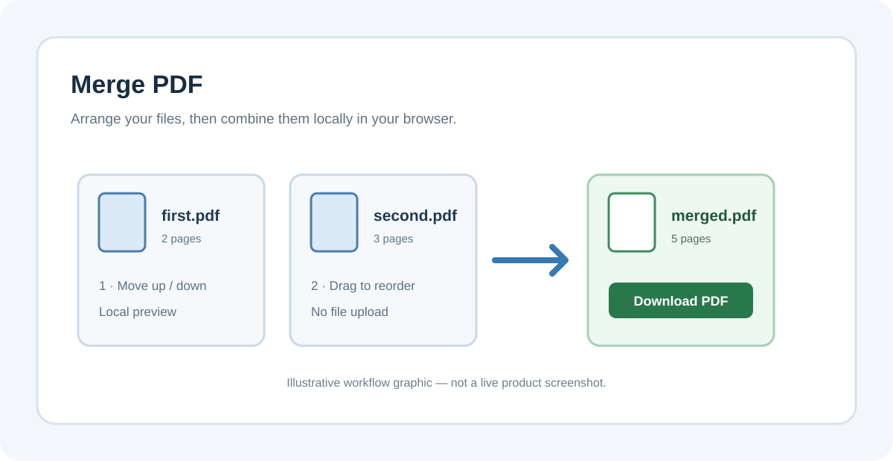

# Files Format

Files Format is a free, open-source collection of PDF, image, text and data utilities. Ordinary file processing stays in your browser: local tools do not send selected files to a Files Format processing server.

Live website: https://gaurav01mh.github.io/everyday-tools-python/
Source code: https://github.com/Gaurav01MH/everyday-tools-python

## PDF merge preview



The graphic is an illustration of the workflow, not a screenshot of the live interface.

## Tools

### PDF
- Merge, split, extract and rotate pages; render PDF pages to PNG.
- Compress PDF structure and metadata. Embedded images are not recompressed.
- Reorder or remove pages from thumbnail previews.
- Convert images to PDF; add page numbers and text watermarks.

### Images
- Resize and convert JPG, PNG, WEBP and BMP.
- Compress toward a target size such as 100 KB. The target is best-effort.
- Remove common EXIF/image metadata by re-exporting.
- Fit photos to common passport/ID print presets.

### Text and data
- Text statistics, case conversion and line cleanup.
- JSON formatting/validation; CSV/JSON conversion.
- URL/Base64 encoding and decoding; percentage and unit conversion.
- Generate QR codes locally from text or URLs.

The catalogue contains 35 tools. Each tool has a direct route such as /merge-pdf/ with its own title, description, H1, FAQ, canonical URL and social metadata.

## Privacy and file handling

- Local tools process files in the browser and do not send selected files to a Files Format processing server.
- Link Tool and QR Tool are designed as upload-based sharing options, but are disabled on the current GitHub Pages deployment. Nothing is uploaded by them on this version.
- No account or advertising is required.
- Verify local processing in browser DevTools → Network while running a local tool.

## Current limits

- 100 MB total selected input; 50 MB per PDF.
- Images up to 20 MB and 16 megapixels each.
- Up to 20 files per batch; 250 PDF pages.
- PDF previews and PDF-to-image rendering are capped at 100 pages.
- Generated PDF or ZIP output is limited to 100 MB.
- Password-protected PDFs, OCR, PDF text editing, digital signatures, form filling, annotation editing and animated image processing are not supported.

PDF compression optimises structure and selected metadata; it does not recompress embedded images. Image target-size compression is best-effort and may not reach the requested size without changing quality or dimensions.

## Development

Requirements: Node.js 22.12 or newer and npm.

From web/, run:

```sh
npm install
npm run dev
npm test
npm run build
node scripts/check-seo-output.mjs
npm run test:e2e
```

The production build generates direct tool pages, category/directory pages, guide pages, robots.txt, sitemap.xml, llms.txt, PNG app icons, a 1200×630 Open Graph image and an offline service-worker precache.

## Search indexing and launch

After deployment, the site owner must verify the property in Google Search Console and submit /sitemap.xml. Search engines decide independently whether to crawl and index the pages.

Public launch posts on Product Hunt, Hacker News and Reddit should be reviewed and published by the project owner; no account action or public post is made automatically.

## License

Original Files Format source is MIT licensed. Third-party dependencies and assets retain their own licences.
